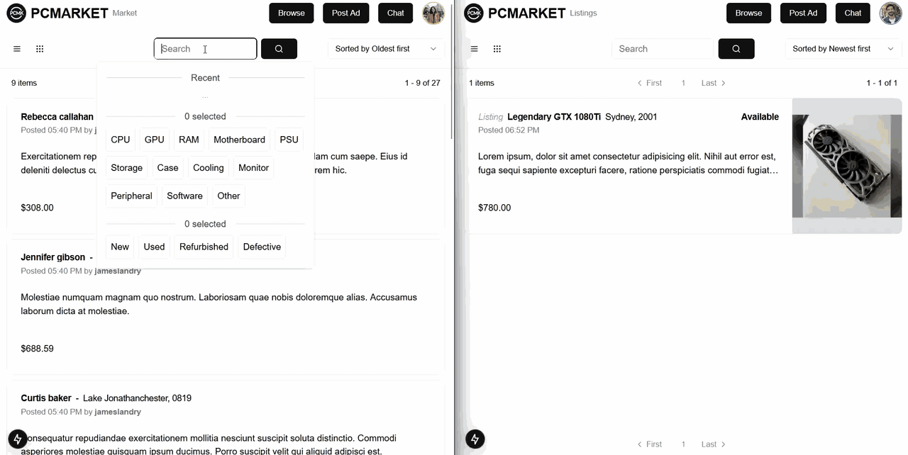

# PC Parts Marketplace

A marketplace for Australians to buy and sell used PC components, with image-first listings, fast search and real-time buyer–seller chat.



## Why
General marketplaces bury PC parts among everything else and don't show the details that matter, such as specs, condition and photos. This one is built just for PC hardware.

## Architecture
```
Browser ─▶ nginx gateway ─┬─▶ web (Next.js)
                          └─▶ api (FastAPI) ─┬─▶ PostgreSQL
                                 └─ /chat/ws (WebSocket) └─▶ Redis (cache)
```
| Service | Folder | Stack |
|---|---|---|
| Web | [`web/`](./web) | Next.js 15, React, Zustand, Tailwind |
| API + chat | [`api/`](./api) | FastAPI, SQLAlchemy, PostgreSQL, Redis |

The Docker Compose files and the nginx gateway config live at the root.

## Key design decisions
| Decision | Why | Trade-off |
|---|---|---|
| Firebase Auth, with tokens checked on the server | Ready-made Google and email/password sign-in, and the API still enforces access | Tied to Firebase |
| Chat inside the API service | One deployment, with auth shared with the rest of the API | Chat and the API scale together |
| Self-hosted behind Cloudflare Tunnel | No exposed ports and no cloud bill | Uptime depends on my own server |

## Stack
Next.js · FastAPI · PostgreSQL · Redis · Firebase Auth · Cloudflare Turnstile · Docker Compose · nginx · Cloudflare Tunnel

## Running it
Runs on Docker Compose: the Next.js web app, the FastAPI API with WebSocket chat, PostgreSQL, Redis and an nginx gateway, with Firebase Auth and Cloudflare Turnstile. See `compose.dev.yml` for the full setup.

## What I'd improve next
- Always-on chat connection: the WebSocket currently opens only while the chat panel is open (and drops when idle), so new messages can take a few seconds to show up. Keeping one connection alive for the whole signed-in session would give instant, Messenger-style notifications anywhere on the site.
- Full-text search with ranking (Postgres `tsvector`)
- Image resizing and CDN delivery
